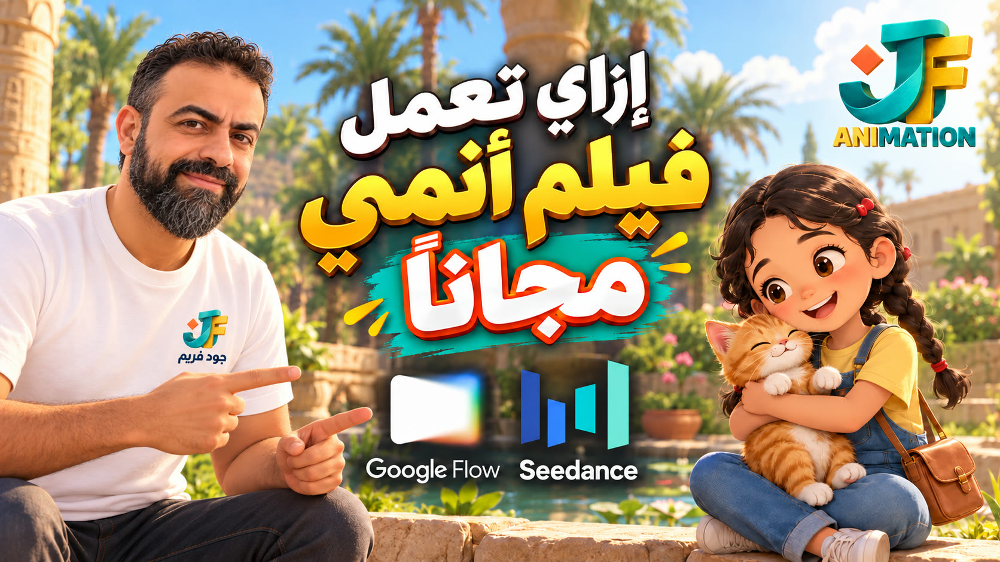

<!-- living-readme: last-sync ee2af94 2026-11-01 -->

# 🎬 Kids anime short films — two skills

Two free AI agent skills that guide you from a short story to a 60-second kids anime film: the story, the characters, the still pictures, the prompts for each shot, and the checks before you publish.

- **`flow-anime-story`** — for **Google Flow** (Omni 1.1 Flash video, Nano Banana images).
- **`seedance-anime-story`** — for **Higgsfield Seedance 2.0 / 2.0 Mini** (Seedream stills, Seedance prompt blocks).

Both work for any story and any lead character: a girl, a boy, an old man, with or without an animal companion. If you have no story, the skill suggests three and builds from the one you pick.

- Full guide for each skill: [flow](flow/README.md) · [seedance](seedance/README.md)
- Skill files: [flow-anime-story/SKILL.md](../flow-anime-story/SKILL.md) · [seedance-anime-story/SKILL.md](../seedance-anime-story/SKILL.md)
- One finished example film (for reference only): [examples/roqa-kids-anime](../examples/roqa-kids-anime/)

---

## العربي

### ما هي السكيلز؟
السكيل ملف تعليمات واحد اسمه `SKILL.md`. تعطيه لأي مساعد ذكاء اصطناعي (Claude أو ChatGPT أو Codex) فيتبعه في المهمة. لا تحتاج تثبيت كود ولا مفاتيح API.

### تعمل إزاي؟
1. **القصة:** تختار قصتك أو تطلب من السكيل ثلاث اقتراحات.
2. **الشخصيات:** وصف ثابت للبطل (وأي رفيق لو عايز)، وشيتات صور قبل أي فيديو.
3. **الكادرات:** كل مشهد 8 ثواني، ومعاه البرومبت الكامل.
4. **الإنتاج:** Flow أو Seedance، مع حساب الكريدت قبل ما تبدأ.
5. **المونتاج والمراجعة:** نهاية الفيلم والحديث وقائمة فحص قبل النشر.

### ملاحظات مهمة
- الصور في Flow مجانية، والفيديو بيتحسب بالكريدت (8 ثواني ≈ 12 كريدت، حسب المشروع اللي اتقاس عليه).
- في Seedance Mini الكلام العربي ما طلعش من الموديل في الاختبار، فالحوار يتسجل في المونتاج.
- أي حديث أو آية لازم تتأكد منها من مصدر موثوق قبل النشر.
- الأمثلة في `examples/` قصة واحدة للمرجعية، مش جزء من السكيل.

### الاستخدام
1. حمّل مجلد السكيل (أو ملف `SKILL.md`) وادّيه لمساعدك.
2. اكتب: «عايز فيلم أنمي قصير للأطفال في Google Flow» أو «… على Seedance».
3. اتبع الخطوات اللي هيقترحها، ووافق على كل خطوة قبل ما يكمّل.

---

## English

### What are these skills?
A skill is one instruction file, `SKILL.md`. Give it to an AI assistant (Claude, ChatGPT or Codex) and it follows the method. No code install, no API keys.

### How it works
1. **Story:** pick yours, or ask the skill for three options.
2. **Characters:** locked descriptions for the lead (and an optional companion), then still sheets before any video.
3. **Shots:** each shot is 8 seconds, with its full prompt.
4. **Production:** Flow or Seedance, with a credit check before you start.
5. **Edit and review:** the end card, the wording check and a checklist before publishing.

### Important notes
- In Flow, still images are free. Video uses credits (one 8-second video ≈ 12 credits, measured on one project).
- In Seedance 2.0 Mini, Arabic speech did not come out in testing, so dialogue is recorded in the edit.
- Any quote or hadith must be checked on a reliable source before publishing.
- The examples in `examples/` are one story, for reference only, not part of the skill.

### Usage
1. Download the skill folder (or just `SKILL.md`) and give it to your assistant.
2. Ask: "Make a 60-second kids anime short in Google Flow" or "… in Seedance".
3. Follow the steps it proposes, and approve each one before it continues.

---

## Files

| File | What it is |
| :--- | :--- |
| `flow-anime-story/SKILL.md` | Google Flow method |
| `seedance-anime-story/SKILL.md` | Seedance method |
| `examples/roqa-kids-anime/` | One example film: shot prompts and packs |
| `assets/cover-16x9.jpg` | Cover image of the example film |

## License

CC BY 4.0. Free to use and adapt with attribution. See [LICENSE](../../LICENSE).
