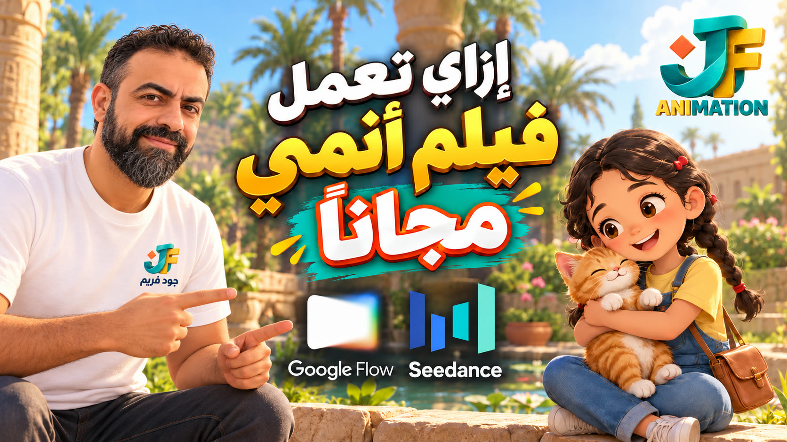

<!-- living-readme: last-sync f5d8b9f 2026-11-01 -->

<div align="center">

# 🎬 flow-anime-story

*A method for making a 60-second kids anime short in Google Flow, from the story to the last shot.*



[What it is](#what-it-is-and-what-it-is-not) • [What's inside](#whats-inside) • [How it works](#how-it-works) • [Use it](#how-to-use-it) • [Limits](#status--honest-limits) • [Checklist](#checklist)

</div>

---

## What it is, in plain words

If you want to make a short, gentle cartoon for children in Google Flow, this skill tells your AI assistant how to do it step by step. You give it a story, or ask it to suggest one. It then writes the character descriptions, the picture sheets, and a prompt for every 8-second shot, and reminds you what to check before you publish.

**For developers:** a single `SKILL.md` instruction file, Markdown only, no code, no dependencies. Works with any assistant that can read a file.

## What it is / what it is NOT

- **It IS** a method: story, locks, sheets, shots, credits, edit, checklist.
- **It IS** for any story and any lead character: a girl, a boy, an old man, with or without an animal companion.
- **It is NOT** a generator. It does not create video. You (or your assistant with access to Flow) do that inside Google Flow.
- **It is NOT** a source of religious text. Any quote or hadith must be checked on a reliable source before you publish.
- **It is NOT** a promise of free video. Images are free in Flow; video uses credits.

## What's inside

| Section | What it covers | Where to verify |
| :--- | :--- | :--- |
| 1. Story | Suggest three options or use yours; beat sheet of seven shots | `flow-anime-story/SKILL.md` § 1 |
| 2. Locks | Character, companion, style, location, audio, camera | § 2 |
| 3. Sheets | Character, companion and location sheets before any video | § 3 |
| 4. R2V | Reference-to-Video with @ mentions, shot template | § 4 |
| 5. Credits | Images free, video about 12 credits per 8 s, split across accounts | § 5 |
| 6. Policy | Child-safe wording, names of real people, rewrites | § 6 |
| 7. Browser driving | Waiting, the @ picker, previews | § 7 |
| 8. Edit | 16:9, end card built outside Flow, loudness | § 8 |
| 9. Checklist | Pre-publish list | § 9 |

## How it works

```
Story (yours, or 3 suggestions)
        │
        ▼
Locks: character · companion · style · location · audio · camera
        │
        ▼
Sheets (free): character · companion · location   ← approve each
        │
        ▼
Keyframes (free), 1–2 per shot                     ← approve each
        │
        ▼
Video, R2V: @sheet + @keyframe, 8 s each (credits)
        │
        ▼
Edit: 16:9, end card, sound  →  Checklist  →  publish
```

Decisions the skill makes for you, and why:
- **Sheets before video.** A new sheet is a different character, so approve them first.
- **R2V over first-frame.** First-frame takes one image, so the sheets cannot guide the face.
- **End card outside Flow.** Exact wording needs checking, and Flow can drift on text.

## How to use it

1. Download the folder `cinematic/flow-anime-story/` (or just `SKILL.md`) and give it to your assistant.
2. Ask: *"Make a 60-second kids anime short in Google Flow."*
3. If you have no story, it will suggest three. Pick one.
4. Approve each sheet and keyframe before it moves on.

## Status & honest limits

**Status (2026-11-01):** the method was used on one example film (seven shots, Google Flow). The example is in [`examples/roqa-kids-anime/`](../../examples/roqa-kids-anime/) for reference only.

1. The example is one story. Other stories have not been tested with this exact text.
2. Credit numbers come from one project and one period. Check your own balance.
3. Flow's policy filter can block a prompt. The skill's wording rules reduce this, but do not remove it.
4. The skill does not record the audio. Dialogue is written as prompt text and checked by ear.

## Quality gates

Run through section 9 before publishing:
- [ ] Story and moral chosen; any quote verified
- [ ] Lead character and companion locks written
- [ ] Sheets and keyframes approved
- [ ] Each video is R2V with @sheet + @keyframe (or first-frame accepted on purpose)
- [ ] Credit balance covers the remaining shots
- [ ] Prompts pass the child-safety and naming rules
- [ ] End card built in the edit, wording verified

## Repo map

| Path | Purpose |
| :--- | :--- |
| `flow-anime-story/SKILL.md` | The method (the file an assistant reads) |
| `flow-anime-story/references/` | Lock text and the shot template |
| `examples/roqa-kids-anime/` | One complete example, reference only |
| `anime-kids-skills/` | This guide and the cover image |

## Documents & where to verify

| Question | Document |
| :--- | :--- |
| What exactly does each step say? | [`SKILL.md`](../../flow-anime-story/SKILL.md) |
| How do I write a lock? | [`references/locks.md`](../../flow-anime-story/references/locks.md) |
| How do I write one shot? | [`references/shot-prompt.md`](../../flow-anime-story/references/shot-prompt.md) |
| What does a finished film look like? | [`examples/roqa-kids-anime/`](../../examples/roqa-kids-anime/) |

## Licence and attribution

CC BY 4.0. Free to use and adapt with attribution. See the [licence](../../../LICENSE). Made by Khaled Al Refay.

---

🇸🇦 **بالعربي:** سكيل بيساعدك تعمل فيلم أنيميشن قصير للأطفال (60 ثانية) في Google Flow، من القصة لحد آخر لقطة. بتدي للمساعد قصة أو تطلب منه يقترح، وهو يكتب وصف الشخصيات وصور الشيت والبرومبت لكل لقطة 8 ثواني، ويفكرك بالفحص قبل النشر. الصور في Flow مجانية، والفيديو بيتحسب بالكريدت. الحديث أو الحديث الشريف لازم يتأكد منه قبل النشر.
