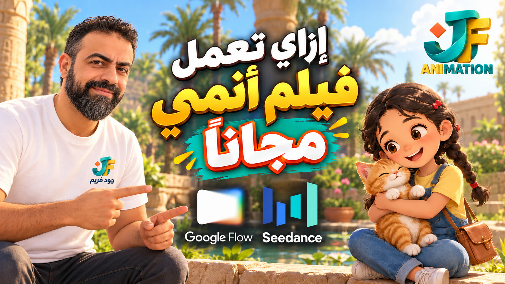

<!-- living-readme: last-sync f5d8b9f 2026-11-01 -->

<div align="center">

# 🎬 seedance-anime-story

*A method for making a 60-second kids anime short on Higgsfield Seedance, from the story to the last shot.*



[What it is](#what-it-is-and-what-it-is-not) • [What's inside](#whats-inside) • [How it works](#how-it-works) • [Use it](#how-to-use-it) • [Limits](#status--honest-limits) • [Checklist](#quality-gates)

</div>

---

## What it is, in plain words

If you want to make a short cartoon for children with Seedance on Higgsfield, this skill tells your AI assistant how to do it. You give it a story, or ask it to suggest one. It then writes the locks, the Seedream picture sheets and keyframes, and a Seedance prompt for each shot, and it asks you to confirm the model and the cost before anything is generated.

**For developers:** a single `SKILL.md` instruction file, Markdown only, no code, no dependencies. Works with any assistant that can read a file.

## What it is / what it is NOT

- **It IS** a method: model and cost check, story, locks, sheets, Seedance blocks, edit, checklist.
- **It IS** for any story and any lead character: a girl, a boy, an old man, with or without an animal companion.
- **It is NOT** a generator. It writes the prompts; you generate in Higgsfield.
- **It is NOT** able to make Arabic speech come out of Seedance Mini. Dialogue is recorded in the edit.
- **It is NOT** a price list. Costs change; confirm on the Higgsfield page.

## What's inside

| Section | What it covers | Where to verify |
| :--- | :--- | :--- |
| 1. Model and cost | Ask for model, tier and cost before generating | `seedance-anime-story/SKILL.md` § 1 |
| 2. Story | Suggest three options or use yours | § 2 |
| 3. Language limit | Seedance writes English prompts; Arabic speech planned for the edit | § 3 |
| 4. Locks | Character, companion, style, location, audio | § 4 |
| 5. Sheets | Seedream sheets and keyframes | § 5 |
| 6. Seedance blocks | The block order, FOV steps, positive wording | § 6 |
| 7. Shot list | Seven shots of 8 s, one change each | § 7 |
| 8. Edit | End card outside the generator, loudness | § 8 |
| 9. Checklist | Pre-publish list | § 9 |

## How it works

```
Model + cost confirmed by you  ← required before any generation
        │
        ▼
Story (yours, or 3 suggestions)  →  Locks
        │
        ▼
Seedream sheets (free)  →  Seedream keyframes (free)  ← approve each
        │
        ▼
Seedance blocks per shot: start_image = keyframe, @image1 = character,
                          @image2 = companion (only if in frame)
        │
        ▼
Edit: end card, Arabic voice, bars  →  Checklist  →  publish
```

Decisions the skill makes for you, and why:
- **Cost first.** A bigger model or a longer clip needs a fresh yes.
- **Blocks in a fixed order.** The model reads the context first, then the camera, then the action.
- **English prompts, Arabic in the edit.** Seedance Mini did not produce Arabic speech in testing.

## How to use it

1. Download the folder `cinematic/seedance-anime-story/` (or just `SKILL.md`) and give it to your assistant.
2. Ask: *"Make a 60-second kids anime short on Seedance."*
3. Confirm the model, tier and cost it asks for.
4. Approve each sheet and keyframe before any video.

## Status & honest limits

**Status (2026-11-01):** the method was used on one example film (seven shots, Seedance Mini for the comparison). The example is in [`examples/roqa-kids-anime/`](../../examples/roqa-kids-anime/) for reference only.

1. The example is one story. Other stories have not been tested with this text.
2. Seedance Mini did not produce Arabic speech in testing. Full 2.0 was not tested for speech here.
3. Costs come from one project and one period. Confirm on the page.
4. The skill does not generate or review video. It writes prompts and a checklist.

## Quality gates

Run through section 9 before publishing:
- [ ] Model, tier and cost confirmed by you
- [ ] Story and moral chosen; any quote verified
- [ ] Locks written; characters are child-safe
- [ ] Sheets and keyframes approved before video
- [ ] `start_image` is this shot's keyframe; only tagged references are in the shot
- [ ] Each prompt has the blocks it needs, in order, in positive form
- [ ] Arabic dialogue planned for the edit
- [ ] End card built outside the generator, wording verified

## Repo map

| Path | Purpose |
| :--- | :--- |
| `seedance-anime-story/SKILL.md` | The method (the file an assistant reads) |
| `seedance-anime-story/references/` | Block rules and the prompt-block template |
| `examples/roqa-kids-anime/` | One complete example, reference only |
| `anime-kids-skills/` | This guide and the cover image |

## Documents & where to verify

| Question | Document |
| :--- | :--- |
| What exactly does each step say? | [`SKILL.md`](../../seedance-anime-story/SKILL.md) |
| How do I write a Seedance block? | [`references/prompt-blocks.md`](../../seedance-anime-story/references/prompt-blocks.md) |
| What does a finished film look like? | [`examples/roqa-kids-anime/`](../../examples/roqa-kids-anime/) |

## Licence and attribution

CC BY 4.0. Free to use and adapt with attribution. See the [licence](../../../LICENSE). Made by Khaled Al Refay.

---

🇸🇦 **بالعربي:** سكيل بيساعدك تعمل فيلم أنيميشن قصير للأطفال (60 ثانية) على Seedance في Higgsfield. قبل أي توليد، لازم تأكد من الموديل والباقة والتكلفة. بعدين هيكتب الشخصيات وصور الشيت والـ keyframes، وبرومبت Seedance لكل لقطة. البرومبتات بالإنجليزي، والحوار العربي بيتسجل في المونتاج، لأن Seedance Mini ما طلعش كلام عربي في الاختبار.
