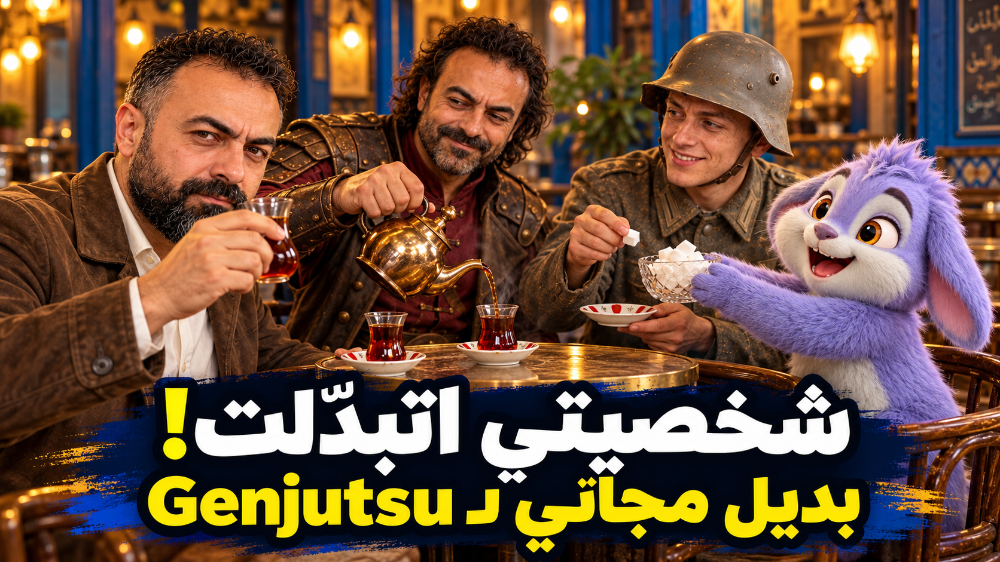

# gemini-getsu

### Google Flow prompts for swapping a character while keeping the original scene



*One café scene, one original clip, and three character swaps.*

[Watch the video](https://youtu.be/rqd7bbIMQ4Q) · [Download this skill](https://github.com/drkhaledalrefay-coder/refay-skills/archive/refs/heads/main.zip)

---

## بالعربي

**gemini-getsu** بتساعدك تكتب برومبتات جاهزة لـ Google Flow عشان تبدّل الشخصية في فيديو موجود، مع الحفاظ على المشهد وحركة الكاميرا والتوقيت والصوت قدر الإمكان.

بدل ما تبدأ توليد جديد لكل شخصية، بتحدد فيديو مرجعي واحد وصورة مرجعية لكل شخصية. السكيل ترتّب الملفات وتكتب برومبت مستقل لكل تبديل؛ كل مرة تستخدم الفيديو الأصلي نفسه.

### طريقة الشغل

```text
فيديو أصلي + صورة شخصية 1 → برومبت التبديل 1
فيديو أصلي + صورة شخصية 2 → برومبت التبديل 2
فيديو أصلي + صورة شخصية 3 → برومبت التبديل 3
```

### هتحتاج إيه؟

| الملف أو المعلومة | المطلوب |
| --- | --- |
| الفيديو المرجعي | فيديو واحد هنستخدمه كأساس لكل النسخ |
| صور الشخصيات | صورة واحدة واضحة لكل شخصية |
| الحوار | الجملة حرفيًا، مع اللغة واللهجة، لو في كلام |
| شكل التصوير | اختياري؛ لو ما حددتش، نحافظ على شكل الفيديو الأصلي |

### السكيل بتطلع إيه؟

- خريطة بسيطة توضح الفيديو والصورة المستخدمة في كل نسخة.
- برومبت مستقل لكل شخصية، جاهز للنسخ في Google Flow.
- تأكيد واضح على إيه اللي يتغيّر وإيه اللي يفضل زي ما هو.
- الحوار بنفس الكلمات واللغة واللهجة اللي كتبتها.
- قائمة مراجعة قبل التوليد وبعده، عشان تراجع الصوت والشخصية والموبايل والنصوص الظاهرة.

### التثبيت والاستخدام

1. من صفحة المستودع على GitHub، اختار **Code → Download ZIP** وفك الضغط.
2. انسخ مجلد `cinematic/gemini-getsu` كاملًا إلى مجلد `skills` الخاص بالمساعد اللي بتستخدمه. تأكد إن المسار النهائي فيه `gemini-getsu/SKILL.md`.
3. افتح محادثة جديدة وأرفق الفيديو الأصلي وصورة مرجعية لكل شخصية.
4. اطلب مثلًا: **«اكتب لي برومبتات Google Flow لتبديل الشخصيات في الفيديو ده»**.
5. راجع خريطة الملفات والبرومبتات، وبعدها انسخ كل برومبت بنفسك إلى Google Flow.

لو الأداة اللي بتستخدمها ما بتدعمش Skills، افتح [`portable-prompt.md`](portable-prompt.md)، انسخه والصقه في المحادثة مع فكرتك والملفات.

### مهم قبل التوليد

- كل تبديل يبدأ من **الفيديو الأصلي نفسه**؛ ما تستخدمش نتيجة تبديل سابقة كمصدر للتبديل اللي بعده.
- ما تضيفش حوارًا من عندك. لو في كلام، ابعت النص مضبوطًا زي ما عايزه يتقال.
- السكيل بتكتب البرومبتات فقط؛ أنت اللي بتشغّلها في Google Flow وتراجع النتيجة.
- استخدم فيديوهات وصور عندك حق استخدامها، وخد موافقة الشخص لو هتبدّل هويته.

---

## English

**gemini-getsu** helps you write ready-to-paste Google Flow prompts for changing the performer in an existing clip while asking Flow to preserve the scene, camera movement, timing and audio as closely as possible.

Start with one source video and one reference image for each target character. The skill maps the assets and writes a separate prompt for each swap. Every prompt uses the original video again; outputs are never chained together.

### What it returns

- A short asset map for every version.
- One standalone Google Flow prompt per character.
- Clear instructions about what changes and what stays consistent.
- Dialogue copied exactly in its original language and dialect.
- Pre-generation and post-generation checklists for identity, audio, camera continuity and visible artifacts.

### Install and use

1. On GitHub, choose **Code → Download ZIP**, then extract the archive.
2. Copy the complete `cinematic/gemini-getsu` folder into your AI assistant's `skills` directory. The final path should contain `gemini-getsu/SKILL.md`.
3. Start a new chat and attach the original clip plus one reference image per character.
4. Ask for Google Flow prompts for the character swaps.
5. Review the asset map and prompts, then run them yourself in Google Flow.

For an assistant without Skills support, copy [`portable-prompt.md`](portable-prompt.md) into the chat instead.

### Folder contents

| File | Purpose |
| --- | --- |
| [`SKILL.md`](SKILL.md) | Instructions for AI assistants that support skills |
| [`portable-prompt.md`](portable-prompt.md) | Paste-in version for any chat assistant |
| [`FIRST_COMMENT.md`](FIRST_COMMENT.md) | Simple YouTube comment copy |
| [`assets/shared-tea-scene.png`](assets/shared-tea-scene.png) | The café scene artwork shown above |

The skill plans prompts only. You choose when to generate, which assets to use, and whether each result is ready to share.
