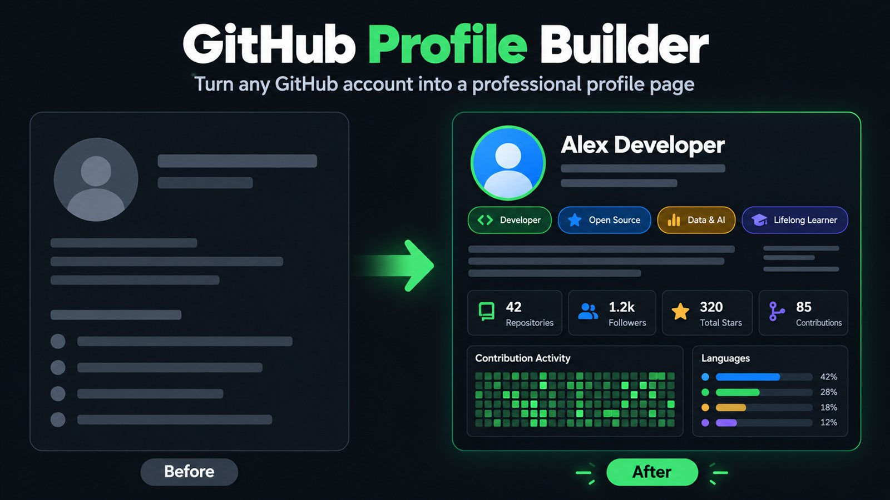
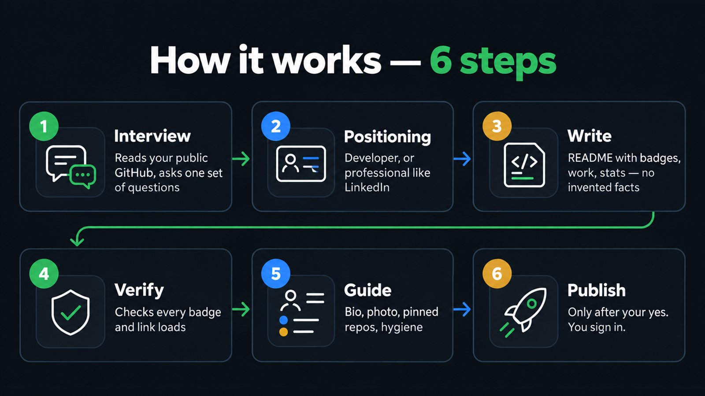
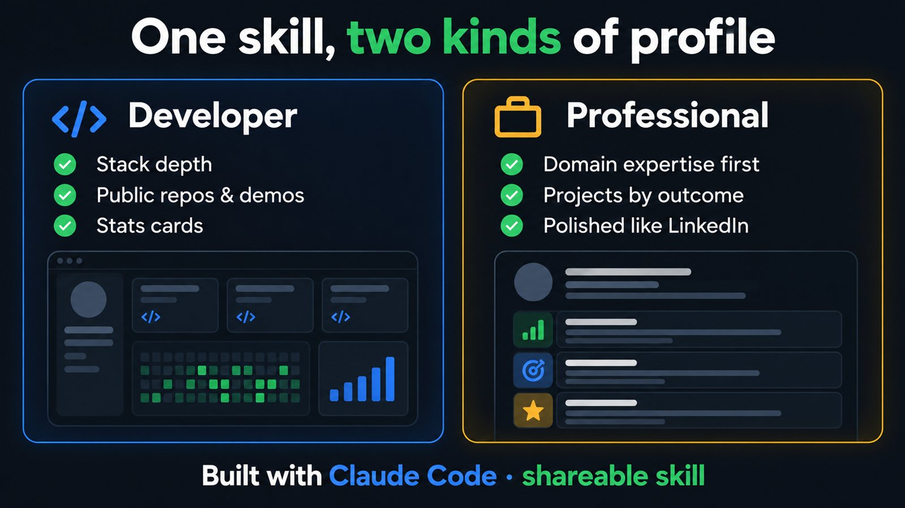

# GitHub Profile Builder

Create a clear, professional GitHub profile README for a developer or for someone who wants their GitHub page to introduce their work like a professional profile.

## At a glance

| | |
| :--- | :--- |
| **Use it for** | A new or refreshed GitHub profile README, bio, and pinned-repository presentation |
| **You need** | Your GitHub username, confirmed work/projects, preferred voice, and what you want visitors to notice |
| **It produces** | A profile README draft, bio/pin suggestions, verified badges or stats, and setup steps |

## How it works

1. **Gather facts.** The assistant asks about your background, projects and goals. It should use details you confirm or can verify.
2. **Choose a profile direction.** Pick a developer-focused profile or a broader professional introduction.
3. **Draft the page.** The assistant writes the profile README and suggests a sidebar bio and pinned repositories.
4. **Check it.** Links, badges and statistics are checked where the included tools support verification.
5. **Publish only with your approval.** You review the final content first. The skill's instructions require explicit approval before publishing.

## Two profile paths

- **Developer profile:** highlight languages, tools, selected projects and contributions that can be verified.
- **Professional profile:** explain your work and expertise in plain language, even if you are not a software developer.

## What to provide

- Your GitHub username.
- Roles, experience, skills and projects you want included.
- The kind of reader you want to reach.
- Any links, badges or statistics you want considered.
- Details that should stay private or should not appear on a public page.

The assistant should not invent credentials, project results, contribution numbers or URLs. If a fact cannot be checked, it should ask you or leave it out.

## Use it

Load the complete `github-profile-builder` folder using the skills method supported by your AI client. If your client does not support Skills, fill out [UNIVERSAL_PROMPT.md](UNIVERSAL_PROMPT.md) and paste it into the chat.

Ask for a GitHub profile README, for example: “Help me make my GitHub profile clear and professional.” Review the draft, then follow the setup steps. The assistant must wait for your explicit approval before publishing.

## Included files

- [SKILL.md](SKILL.md) — the assistant's step-by-step instructions.
- [UNIVERSAL_PROMPT.md](UNIVERSAL_PROMPT.md) — a paste-in version for assistants without Skills support.
- [template/README.md](template/README.md) — profile README starting template.
- [template/PROJECT-README.md](template/PROJECT-README.md) — project detail template.
- [scripts/check-badges.sh](scripts/check-badges.sh) and [scripts/preview.sh](scripts/preview.sh) — badge checks and preview helper.
- `assets/` — the three illustrations shown above.

## License

This skill is part of [Refay Skills](../../README.md) and follows the [CC BY 4.0 license](../../LICENSE).
